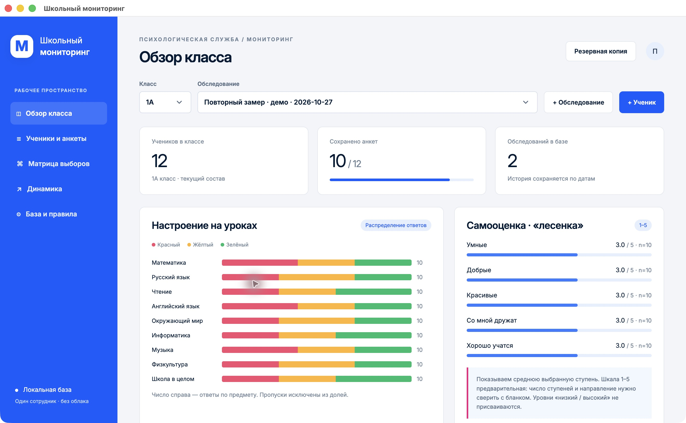

# Школьный мониторинг

Десктопное приложение для одного сотрудника: классы, ученики, три блока анкет, обследования по датам и описательные отчёты. **macOS (Apple Silicon) и Windows x64** используют один код. Приложение работает локально, без сервера, регистрации, облачной синхронизации и сетевых API.

[Скачать готовую сборку для macOS Apple Silicon](https://github.com/pepelaz1/school-monitor-desktop/releases/tag/v0.1.0).



## Возможности

- Отдельная демонстрационная SQLite-база: 48 вымышленных учеников, 4 класса, два периода. В демо намеренно есть неполные периоды.
- Создание пустой рабочей базы, открытие базы/копии и запоминание последнего файла между запусками.
- Добавление ученика (имя или код, класс, параллель 1–4) и обследования с датой.
- Ввод и редактирование настроения по предметам, пяти шкал «лесенки» и выборов одноклассников. Пропуски разрешены и не превращаются в нули.
- Разные вопросы социометрии для 1 и 2–4 классов. Проверки: нельзя выбрать себя, чужой класс, одного человека дважды или одновременно выбрать/исключить в одном вопросе.
- Распределение цветов, средняя ступень с числом ответов, матрица выборов, входящие/исходящие выборы и взаимные пары **по отдельному вопросу**.
- Сравнение периодов с указанием количества ответивших.
- Справка PDF с таблицами и комментарием специалиста; CSV по настроению/лесенке для Excel; резервная копия SQLite. В PDF включаются таблицы входящих социометрических выборов; полная матрица доступна в приложении.
- Сохранение файла базы через временный файл и переименование; уникальность анкеты на пару «ученик + обследование».

## Обработка: что именно считается

Это **предварительные описательные правила**, а не валидированный ключ психологической методики. Основой послужили два бланка «Экспресс 1 классы» и «Экспресс 2–4 классы» из описания задачи. Исходные документы в репозиторий не включены. Полные ключи, нормы, авторство/версия методик и требуемая форма справки не предоставлены.

| Блок | Расчёт | Ограничение |
|---|---|---|
| Настроение | Число красных/жёлтых/зелёных ответов и доли среди заполненных ответов по предмету | Цвета не переводятся в произвольный «психологический балл»; общий вопрос школы отдельный. Для 1 класса общий вопрос касается понедельника |
| Лесенка | Исходная ступень 1…N, среднее и число заполненных ответов отдельно по каждой шкале | По умолчанию N=5 **как демонстрационное допущение**, сверить с бланком. N можно изменить на 3…10 только в базе без ответов. 1 — низ, N — верх |
| Выборы | Направленные связи, число входящих/исходящих выборов, взаимные пары для одного вопроса | Нет общего рейтинга детей, категорий «изолированный», диагноза или автоматических решений |
| Динамика | Независимые сводки по датам | Разный состав/заполненность влияют на результат; это не парный статистический анализ и не доказательство изменений |

Красный: «чаще плохое настроение». Жёлтый: «настроение хорошее, но не люблю отвечать у доски». Зелёный: «настроение отличное, люблю отвечать у доски». Сохраняются именно эти категории, без медицинской интерпретации.

Первоклассники выбирают до двух одноклассников для похода, олимпиады, дня рождения и одного — в вопросе о нехватке билета в кино. Во 2–4 классах для каждого из первых трёх вопросов доступны до двух положительных и до двух отрицательных выборов. В PDF знак `+` означает выбор, `−` — исключение по формулировке вопроса, а не характеристику ребёнка.

Психолог подтверждает правила обработки и пишет итоговое заключение. Пустая анкета может быть сохранена: счётчик означает «запись сохранена», а не полную заполненность.

## Запуск из исходников

Нужны Node.js и npm, совместимые с Electron/Packager из `package-lock.json` (разработка: Node 26; CI: Node 24).

```sh
npm ci
npm test
npm start
```

При первом запуске открывается демо. Для реальной работы выберите **«Создать пустую базу»**, затем добавьте ученика и обследование. Одну базу следует открывать в одном экземпляре приложения. Для другой структуры шкалы используйте отдельную базу.

Демо по умолчанию хранится в каталоге данных приложения Electron (`SchoolMonitor`); полный путь виден в разделе «База и правила». Пользователь сам выбирает расположение рабочей базы. Имена, ответы, комментарии, PDF, CSV и копии **не включаются в Git**.

## Локальная сборка

На Mac с Apple Silicon:

```sh
npm run package:mac
open 'dist/Школьный мониторинг-darwin-arm64/Школьный мониторинг.app'
```

На Windows или для упаковки Windows x64:

```sh
npm run package:win
```

Результат Windows — папка `dist/SchoolMonitor-win32-x64`, запуск `SchoolMonitor.exe`. Для переноса нужна **вся папка**, а не только exe. Windows-сборка предусмотрена, но её нативное выполнение нужно проверять на Windows. Сборки не подписаны сертификатами разработчика; нотариализация Apple и Windows Authenticode не настроены. Готовая macOS-папка — результат локальной сборки, а не установщик для всех архитектур.

## Архитектура и данные

- Electron: изолированный renderer, выключенный Node integration, sandboxed preload, ограниченный набор IPC-операций, запрещённые внешние окна/переходы.
- SQLite через `sql.js`; файлы записываются локально. Нет нативных SQLite-зависимостей, требующих отдельной сборки для ОС.
- Renderer: HTML/CSS/JavaScript; чистые функции обработки отделены от UI и покрыты тестами.
- База и копии **не шифруются самим приложением**. Для реальных детских данных нужны защищённая учётная запись, шифрование диска и контроль доступа к экспортам/копиям. Встроенного логина или многопользовательских ролей нет.
- Экспорт CSV экранирует кавычки/переводы строк и нейтрализует значения, похожие на формулы. PDF экранирует текст и генерируется локально.

## Границы первой версии

Нет облака, OCR бумажных бланков, автодиагностики, Word/DOCX-экспорта, импорта учеников из Excel, редактирования состава прошлых периодов, переноса учеников между классами, удаления анкет/учеников и фоновых резервных копий. Состав класса для сводок берётся текущий, поэтому изменение состава нужно учитывать при сравнении дат. Не меняйте число ступеней в уже заполненной базе. Нормативы и согласованные шаблоны справки — следующий отдельный этап.

## Проверки

`npm test` проверяет исключение пропусков, изоляцию классов/периодов, средние, отдельные социометрические вопросы, взаимные пары, запрещённые выборы и границы шкал, CSV и реальное сохранение/повторное открытие SQLite. Результаты нативной проверки Mac описаны в [QA.md](docs/QA.md).
